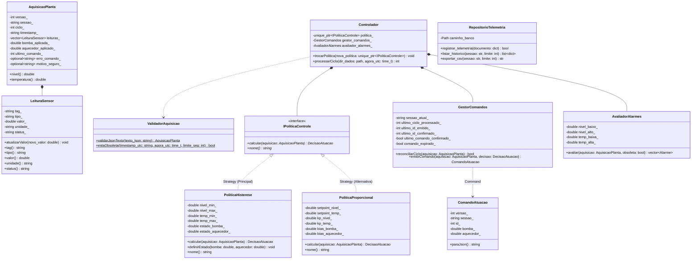

# Projeto Final POO — Fermentador Cervejeiro: Planta, Controlador C++ e Supervisório

Sistema integrado de automação local composto por **três processos independentes** que se comunicam por snapshots JSON atômicos em `dados/`:
1. **Planta Simulada (`planta/simulador.py` — Python)**: Simula a dinâmica termo-hidráulica de uma dorna de fermentação cervejeira (nível de mosto `LT-01` em `%` e temperatura de fermentação `TT-01` em `°C`), respondendo aos atuadores `bomba` e `aquecedor`.
2. **Controlador Automático (`controlador/` — C++17)**: Adquire e valida `dados/planta.json`, aplica a política de controle polimórfica (**Padrão Strategy**: `PoliticaHisterese` ou `PoliticaProporcional`), gerencia o ciclo de vida das solicitações de atuação (**Padrão Command**: emissão única por ciclo, confirmação de ID e detecção de expiração) e publica `dados/comando_planta.json` e `dados/telemetria.json`.
3. **Supervisório (`supervisor/` — Python/Streamlit + SQLite)**: Valida a telemetria e diagnostica obsolescência do snapshot, persiste o histórico sem duplicação em SQLite (**Padrão Repository** com chave primária composta `(sessao, ciclo)`), apresenta leituras, atuação observada, confirmação, alarmes e gráficos temporais, e exporta os dados consultados em CSV.

> Consulte o estudo arquitetural completo, trade-offs e diagramas adicionais em [`docs/ARQUITETURA_E_DECISOES.md`](docs/ARQUITETURA_E_DECISOES.md) e a especificação do protocolo em [`docs/CONTRATO.md`](docs/CONTRATO.md).

---

## 1. Cenário, Grandezas, Atuadores, Parâmetros e Limites do Modelo

| Elemento | Identificador no Contrato | Faixa / Parâmetros Configurados | Papel no Processo de Fermentação |
|---|---|---|---|
| **Nível de Mosto** | Tag `LT-01` · `tipo: "nivel"` · `unidade: "%"` | Faixa física: `[0.0%, 100.0%]` (Inicial: `50.0%`)<br>Banda de Histerese: **`[55.0%, 65.0%]`**<br>Setpoint Proporcional: **`60.0%`** ($K_p = 4.0$) | Garante volume útil na dorna preservando `35%` de *headspace* para espuma. |
| **Temperatura de Fermentação** | Tag `TT-01` · `tipo: "temperatura"` · `unidade: "C"` | Faixa física: `[0.0 C, 100.0 C]` (Inicial: `25.0 C`)<br>Banda de Histerese: **`[33.0 C, 37.0 C]`**<br>Setpoint Proporcional: **`35.0 C`** ($K_p = 8.0$) | Mantém a levedura (*Kveik / Ale*) na faixa metabólica ativa. |
| **Bomba de Mosto** | Atuador `bomba` (`0.0%` a `100.0%`) | Equilíbrio físico na planta: **`33.33%`** ($\Delta \text{nivel} = 0$) | Compensa a extração contínua de `-1.0%/ciclo` da planta. |
| **Camisa Térmica** | Atuador `aquecedor` (`0.0%` a `100.0%`) | Equilíbrio físico a `35 C`: **`40.00%`** ($\Delta \text{temp} = 0$) | Compensa a perda térmica natural de `4%` em direção ao ambiente (`20 C`). |
| **Alarmes de Nível** | `NIVEL_BAIXO` (`aviso`) / `NIVEL_ALTO` (`critico`) | Fronteiras explícitas: `< 25.0%` e `> 85.0%` | Previne cavitação da bomba (`< 25%`) e transbordo/*blow-off* (`> 85%`). |
| **Alarmes de Temperatura** | `TEMP_BAIXA` (`aviso`) / `TEMP_ALTA` (`critico`) | Fronteiras explícitas: `< 22.0 C` e `> 45.0 C` | Previne dormência (`< 22 C`) e morte térmica da levedura (`> 45 C`). |
| **Obsolescência e Watchdog** | `AQUISICAO_OBSOLETA` / `timeout_comando` | Idade máxima: **`10 segundos`**<br>Watchdog da planta: **`5 ciclos`** sem comando novo | Detecta parada de processos e leva atuadores a `0%` por segurança. |

---

## 2. Dependências e Ambiente Limpo

- **C++17**: `g++` (GCC 11+), `gcov` e `GNU Make`.
  - Biblioteca JSON C++: **JSON for Modern C++ (`nlohmann/json.hpp` v3.11.3)** incluída diretamente como cabeçalho único em `controlador/vendor/nlohmann/json.hpp` (sem necessidade de instalação externa e isolada da medição de cobertura autoral).
- **Python 3.12+**: Biblioteca padrão (`sqlite3`, `json`, `unittest`, `csv`) para planta e repositório; ambiente virtual `.venv` com `requirements-dev.txt` (`streamlit`, `coverage`, `gcovr`) para tela e relatórios de cobertura.

### Preparação Reproduzível em Ambiente Limpo (Linux / WSL)

```bash
python3 -m venv .venv
.venv/bin/python -m pip install -r requirements-dev.txt
make build
```

---

## 3. Como Compilar e Executar os Três Processos Separados

Abra **três terminais independentes** na raiz do repositório:

### Terminal 1 — Planta Simulada (Python)
```bash
make planta
# Ou com parâmetros customizados:
python3 -m planta.simulador --dados dados --intervalo 1 --seed 7
```

### Terminal 2 — Controlador Automático (C++)
```bash
# Execução de um único ciclo (usada em scripts e testes):
./build/controlador --dados dados --uma-vez

# Execução contínua com a política padrão (Histerese):
./build/controlador --dados dados --politica histerese

# Execução contínua com a segunda política (Proporcional):
./build/controlador --dados dados --politica proporcional
```

### Terminal 3 — Supervisório (Python / Streamlit + SQLite)
```bash
make supervisor PYTHON=.venv/bin/python
```

---

## 4. Diagrama de Classes UML e Padrões de Projeto



### Resumo dos Padrões Aplicados
1. **`Strategy` (`IPoliticaControle`, `PoliticaHisterese`, `PoliticaProporcional`)**:
   - **Problema**: Variar a lei matemática de controle (banda morta com memória vs. ação contínua proporcional ao erro) sem acoplar cálculos e estados ao orquestrador de arquivos.
   - **Alternativa mais simples**: Condicional `if/else` dentro de `Controlador`, descartada por misturar estados de histerese e ganhos proporcionais na mesma classe.
2. **`Command` (`ComandoAtuacao`, `GestorComandos`)**:
   - **Problema**: Rastrear identidade (`id` crescente por `sessao`), garantir idempotência ao reler o mesmo ciclo (inclusive entre execuções `--uma-vez` via `dados/controlador_estado.json`) e reconciliar confirmação (`ultimo_comando`) e expiração (`comando_expirado`).
   - **Alternativa mais simples**: Gravar JSON diretamente a partir de `double`, descartada por não preservar rastreio entre ciclos.
3. **`Repository` (`RepositorioTelemetria` em Python/SQLite)**:
   - **Problema**: Persistir histórico deduplicado por `(sessao, ciclo)` e exportar CSV sem acoplar consultas SQL ao ciclo de *rerun* da interface Streamlit.
   - **Alternativa mais simples**: Queries SQLite diretas em `supervisor/app.py`, descartadas por impedir testes unitários isolados sem UI.

---

## 5. Matriz de Testes Autorais (Comum, Fronteira, Falha e Lacunas Conhecidas)

| Objeto / Método | Requisito Verificado | Caso de Teste e Entrada | Resultado Esperado e Estado Preservado | Arquivo de Teste | Lacuna Conhecida / Justificativa |
|---|---|---|---|---|---|
| `LeituraSensor` / construtor e `atualizarValor` | Requisito 2 e 6 (aquisição de 2 grandezas e recusa de leitura inválida) | **Comum**: `60.0%`<br>**Fronteira**: `0.0%` e `100.0%`<br>**Falha**: `-0.01`, `100.01`, `NaN`, unidade trocada, `status="falha"` | Aceita `[0, 100]`; lança `std::invalid_argument` fora da faixa e **preserva o valor `100.0` anterior**. | `tests/cpp/autorais_aquisicao.cpp` | Não modela sensores extras além de nível e temperatura, pois o contrato fixa 2 grandezas. |
| `ValidadorAquisicao` / `validarJsonTexto` e `estaObsoleta` | Requisito 5 e 6 (validar `planta.json`, tipos estritos e dados antigos) | **Comum**: JSON válido ciclo 4<br>**Fronteira**: idade `== 5s` vs `6s` (limite `5s`)<br>**Falha**: `versao: true`, JSON truncado, grandeza ausente | Retorna `AquisicaoPlanta` íntegra; `estaObsoleta == false` em `5s` e `true` em `6s`; rejeita booleanos em campos inteiros. | `tests/cpp/autorais_aquisicao.cpp` | Timestamps com frações de segundo (`.123Z`) são recusados pois o contrato especifica `AAAA-MM-DDTHH:MM:SSZ`. |
| `AvaliadorAlarmes` / `avaliar` | Requisito 7 (alarmes com regra e fronteira explícitas + obsolescência) | **Comum**: `60%`, `35C`<br>**Fronteira**: `25.0%`, `85.0%`, `22.0C`, `45.0C`<br>**Falha/Crítico**: `24.9%`, `85.1%`, `21.9C`, `45.1C`, `obsoleta=true` | Zero alarmes nas fronteiras exatas; dispara `NIVEL_BAIXO`, `NIVEL_ALTO`, `TEMP_BAIXA`, `TEMP_ALTA` e `AQUISICAO_OBSOLETA`. | `tests/cpp/autorais_aquisicao.cpp` | Severidades são fixas por regra de domínio (`aviso` ou `critico`). |
| `PoliticaHisterese` vs `PoliticaProporcional` | Requisito 3 e 4 (duas estratégias com decisões distintas, fronteiras e estado) | **Comum**: `nivel=58%`, `temp=34C`<br>**Fronteira Histerese**: `55.0%`, `54.9%`, `65.0%`, `65.1%`<br>**Falha**: `definirEstado(-10, 50)` | Para `(58%, 34C)`: Histerese decide `(0%, 0%)` e Proporcional decide `(41.33%, 48.0%)`. Histerese preserva `100%` após tentativa inválida. | `tests/cpp/autorais_controle.cpp` | Ganhos $K_p$ são configurados na inicialização, sem auto-tuning dinâmico. |
| `ComandoAtuacao` e `GestorComandos` | Requisito 4, 5 e 6 (padrão Command, confirmação, expiração, mesmo ciclo e nova sessão) | **Comum**: emissão ciclo 1 (`id=1`) e confirmação ciclo 2<br>**Fronteira**: releitura do ciclo 1; `comando_expirado` no ciclo 7<br>**Falha**: reinício de sessão (`sessao-B`) e `id <= 0` | Releitura do ciclo 1 retorna `false` (não renova comando); ciclo 2 confirma `id=1`; nova sessão reseta contador para `id=1`. | `tests/cpp/autorais_controle.cpp` | Persistência de estado é local em arquivo JSON, sem lock distribuído entre máquinas. |
| `Controlador` / `processarCiclo` e `trocarPolitica` | Requisito 5 e 6 (integração C++, recuperação de arquivo inválido e troca de Strategy) | **Comum**: ciclo 1 -> `id=1`<br>**Falha**: `planta.json` corrompido no meio da operação<br>**Recuperação**: ciclo 2 válido após falha | Retorna erro `1` no JSON corrompido **preservando `telemetria.json` anterior** e retoma emissão normal (`id=2`) no ciclo 2. | `tests/cpp/autorais_controle.cpp` | Ramificações de erro de hardware de disco (`rename` falhando por permissão de SO) não ocorrem em execução normal. |
| `ValidadorTelemetria` e `RepositorioTelemetria` | Requisito 8 e 9 (SQLite deduplicado por `sessao/ciclo`, exportação CSV e caminho E2E) | **Comum**: ciclos 1 e 2 no SQLite + exportação CSV<br>**Fronteira**: releitura/refresh da tela no mesmo `(sessao, ciclo)`<br>**Falha**: telemetria inválida após ciclo válido | `registrar_telemetria` retorna `False` na duplicata mantendo apenas 1 registro no SQLite; CSV exporta exatamente as linhas consultadas. | `tests/autorais_supervisor.py` | Consulta padrão limita-se aos últimos `200` ciclos na UI (`1000` no CSV) para manter responsividade. |
| `BufferEnquadramentoTcp` / `ClienteTcpPlanta` / `ServidorTcpPlanta` | **Bônus TCP (+0,5 pt)**: troca preservando contratos, enquadramento, fragmentação, desconexão e recuperação | **Fragmentação**: JSON dividido em pacotes de 3 a 7 bytes<br>**Coalescência**: 2 JSONs no mesmo `recv()`<br>**Falha/Queda**: desconexão abrupta no meio do quadro e reconexão no ciclo seguinte | Reconstitui quadros completos no delimitador `\n`; descarta meio-quadro órfão ao desconectar; reconecta preservando `sessao`, `ciclo` e confirmando `id=1` -> `id=2`. | `tests/cpp/autorais_tcp.cpp` e `tests/autorais_supervisor.py` | Utiliza sockets locais IPv4 (`127.0.0.1`) sem criptografia TLS, adequado à execução local do contrato. |

---

## 5.1. Extensão Bônus TCP (Enquadramento, Fragmentação, Desconexão e Recuperação)

Sem substituir a operação obrigatória por arquivos JSON locais, o projeto implementa o transporte TCP completo em C++ (`controlador/transporte_tcp.hpp` / `.cpp`) e Python (`supervisor/transporte_tcp.py`):

1. **Enquadramento (*Framing* NDJSON)**:
   - Como um socket TCP (`SOCK_STREAM`) é um fluxo contínuo de bytes sem fronteiras de mensagem nativas, cada documento JSON do contrato (`planta.json`, `comando_planta.json`, `telemetria.json`) é transmitido compactado em uma única linha finalizada pelo delimitador `\n` (*Newline-Delimited JSON*).
2. **Tratamento de Fragmentação e Coalescência**:
   - `BufferEnquadramentoTcp` (C++) e `EnquadradorTcp` (Python) acumulam bytes parciais recebidos em chamadas sucessivas de `recv()`. Se um JSON de 350 bytes chegar dividido em 50 pacotes pequenos, o enquadrador retém os fragmentos até encontrar `\n`, entregando o JSON íntegro ao `ValidadorAquisicao`. Se dois quadros chegarem colados no mesmo `recv()`, ambos são separados e processados em ordem. Um limite máximo (`64 KB`) protege contra estouro de memória caso um fluxo corrompido nunca envie `\n`.
3. **Desconexão, Recuperação e Preservação de Sessão/Ciclo**:
   - Caso a conexão caia no meio de uma transmissão parcial, `limparAoDesconectar()` descarta os bytes incompletos para não contaminar o primeiro quadro da nova conexão.
   - Ao reconectar (`ClienteTcpPlanta::requisitarSnapshotPlanta`), o `Controlador` reconcilia a aquisição com `GestorComandos`: se a planta manteve a mesma `sessao`, a sequência de ciclos e `ultimo_comando` continua normalmente sem reiniciar IDs nem duplicar comandos; se a planta reiniciou, a nova `sessao` é detectada e reconciliada.
   - Para executar o controlador via TCP: `./build/controlador --dados dados --tcp 127.0.0.1:PORTA [--uma-vez]`.

---

## 6. Como Executar os Testes e Gerar Relatórios de Cobertura

```bash
# Executar toda a suíte de testes (C++ autorais + Contratos + Python autorais + AppTest):
make test ETAPA=03 PYTHON=.venv/bin/python

# Gerar relatórios HTML de cobertura C++ (gcovr) e Python (coverage.py):
make cobertura ETAPA=03 PYTHON=.venv/bin/python
```

Os relatórios detalhados de linhas e ramificações ficam disponíveis em:
- **C++ (`controlador/`)**: `build/relatorios/cpp/index.html`
- **Python (`supervisor/` e `planta/`)**: `build/relatorios/python/index.html`

---

## 7. Divisão de Trabalho e Limitações Conhecidas

- **Fork Oficial de Entrega**: `https://github.com/rcristelojr20/poo-planta-controle`
- **Integrantes da Dupla**:
  - **`@rcristelojr20`** (Autor principal nos commits do fork de entrega)
  - **`@jvsilveirasilva1`** (Coautor registrado via `Co-authored-by` e revisor das PRs)
- **Divisão das Entregas**:
  - **Arquitetura e Documentação (`docs/ARQUITETURA_E_DECISOES.md`, UML e Contratos)**: Planejamento conjunto da dupla.
  - **Controlador C++ (`aquisicao`, `alarmes`, `telemetria`, `politicas`, `comando`, `controlador`, `transporte_tcp`) e Testes C++**: Implementação e verificação unitária em C++17.
  - **Supervisório Python (`supervisor/repositorio.py`, `supervisor/app.py`, `supervisor/transporte_tcp.py`) e Testes Python**: Implementação do padrão `Repository` em SQLite, interface Streamlit, servidor/cliente TCP e testes de integração fim-a-fim.
- **Limitações Conhecidas**:
  - A troca de dados por snapshots JSON substitui o estado mais recente a cada ciclo; caso o consumidor seja mais lento que o produtor, ciclos intermediários podem não ser observados (o histórico SQLite registra fielmente todos os ciclos observados sem prometê-los sem perdas).
  - A escrita atômica via arquivo temporário e renomeação (`rename` / `os.replace`) garante documentos completos no mesmo sistema de arquivos local, mas não constitui transação distribuída.
