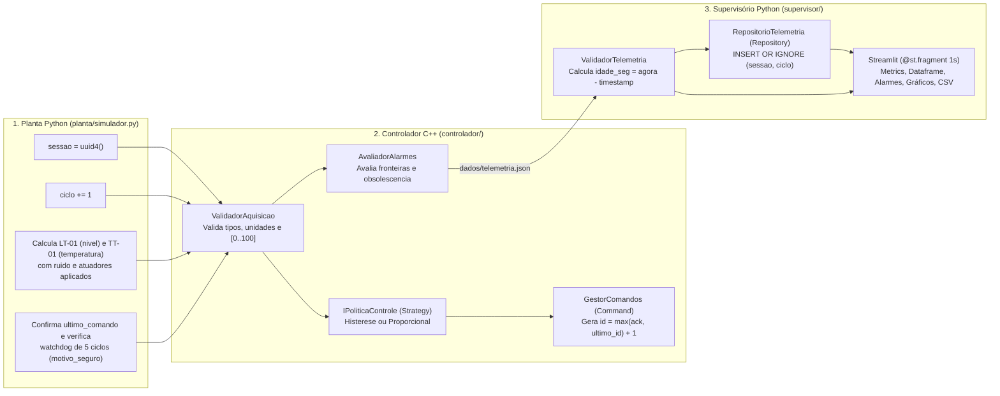
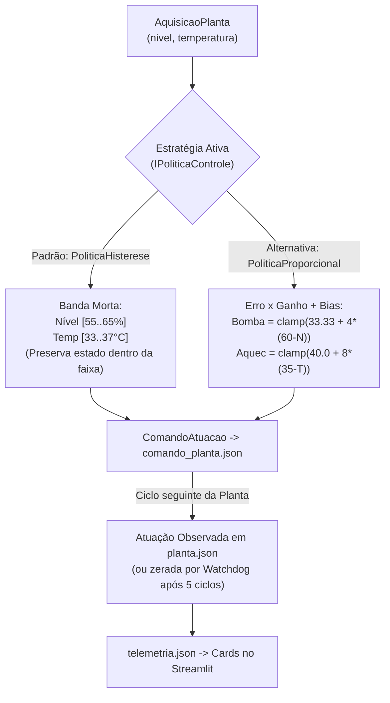
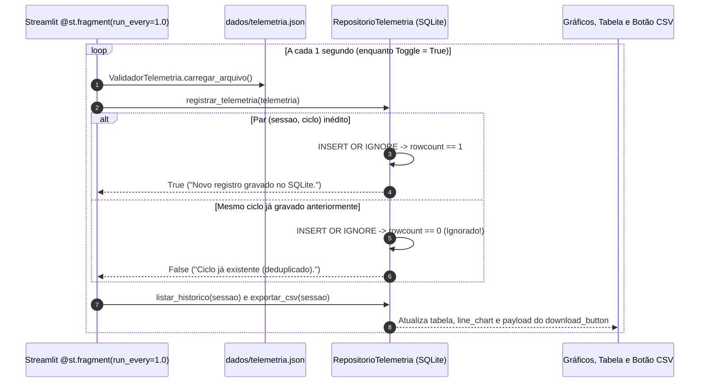

# Guia Técnico das Métricas do Supervisório Streamlit

Este documento explica a **origem, o cálculo matemático, a validação, a persistência e a renderização** de cada métrica, tabela, alarme e gráfico exibido no painel Streamlit ([`supervisor/app.py`](../supervisor/app.py)), servindo como material de apoio técnico para a defesa individual.

---

## 1. Visão Geral do Fluxo de Dados até a Tela

Nenhuma métrica exibida no Streamlit é inventada ou recalculada pela interface. Cada valor nasce na **Planta (`planta/simulador.py`)**, é validado/processado pelo **Controlador C++ (`controlador/`)**, salvo sem duplicação no **SQLite (`supervisor/repositorio.py`)** e apresentado no **Streamlit (`supervisor/app.py`)**:



---

## 2. Cabeçalho e Métricas Principais (Linha 1 de `st.metric`)

No arquivo `supervisor/app.py`, a primeira fileira exibe 4 cards lado a lado:

```python
col1, col2, col3, col4 = st.columns(4)
col1.metric("Sessão", telemetria["sessao"][:12])
col2.metric("Ciclo Atual", str(telemetria["ciclo"]))
col3.metric("Último Comando Confirmado (ID)", str(telemetria["ultimo_comando"]))
col4.metric("Idade da Aquisição", f"{idade_seg:.1f} s")
```

### 2.1. Métrica: `Sessão`
- **O que é**: Identificador único da execução atual da planta (UUID v4). Sempre que a planta é reiniciada, uma nova sessão é criada para impedir que comandos ou ciclos antigos sejam reaproveitados.
- **Como é gerada (`planta/simulador.py`)**:
  ```python
  self.sessao = sessao or str(uuid4())
  ```
- **Como é preservada no C++ (`controlador/comando.cpp`)**:
  ```cpp
  if (sessao_atual_ != aquisicao.sessao() || aquisicao.ciclo() < ultimo_ciclo_processado_) {
      sessao_atual_ = aquisicao.sessao();
      ultimo_ciclo_processado_ = 0;
      ultimo_id_emitido_ = 0;
      ultimo_id_confirmado_ = 0;
  }
  ```
- **Como aparece no Streamlit (`supervisor/app.py`)**: Exibe os 12 primeiros caracteres (`telemetria["sessao"][:12]`) para caber de forma limpa no card.

### 2.2. Métrica: `Ciclo Atual`
- **O que é**: Contador inteiro positivo crescente que identifica cada passo discreto da simulação dentro da sessão atual. O par `(sessao, ciclo)` é a identidade única de cada snapshot.
- **Como é calculada (`planta/simulador.py`)**:
  ```python
  def passo(self, caminho_comando):
      self.ciclo += 1
  ```
- **Onde é usada no Supervisório (`supervisor/repositorio.py`)**:
  ```sql
  PRIMARY KEY (sessao, ciclo)
  ```
  Isso impede que atualizações da tela dupliquem o mesmo ciclo no SQLite.

### 2.3. Métrica: `Último Comando Confirmado (ID)`
- **O que é**: Maior identificador numérico (`id`) de comando enviado pelo controlador C++ que a planta já leu, validou e aplicou efetivamente.
- **Como o ID é criado no C++ (`controlador/comando.cpp`)**:
  ```cpp
  ComandoAtuacao GestorComandos::emitirComando(const AquisicaoPlanta& aquisicao,
                                               const DecisaoAtuacao& decisao) {
      const int proximo_id = std::max(aquisicao.ultimoComando(), ultimo_id_emitido_) + 1;
      ComandoAtuacao cmd(aquisicao.sessao(), proximo_id, decisao.bomba, decisao.aquecedor);
      ...
  ```
- **Como é confirmado pela Planta (`planta/simulador.py`)**:
  ```python
  if identificador < self.ultimo_comando:
      raise ValueError("id antigo; envie um id maior")
  if identificador == self.ultimo_comando:
      return False  # Releitura do arquivo não renova a validade do comando.
  self.atuadores = dict(atuadores)
  self.ultimo_comando = identificador
  self.ciclo_comando = self.ciclo
  ```
- **Como aparece no Streamlit**: Mostra diretamente `telemetria["ultimo_comando"]` (que foi copiado de `planta.json` pelo `EmissorTelemetria`).

### 2.4. Métrica: `Idade da Aquisição` (e Diagnóstico de Obsolescência)
- **O que é**: Tempo decorrido em segundos entre o instante UTC em que a planta gerou o snapshot (`timestamp`) e o relógio atual do supervisório.
- **Como o `timestamp` nasce na Planta (`planta/simulador.py`)**:
  ```python
  instante = datetime.now(timezone.utc).strftime("%Y-%m-%dT%H:%M:%SZ")
  ```
- **Como a idade é calculada no Supervisório (`supervisor/repositorio.py`)**:
  ```python
  @staticmethod
  def calcular_idade_segundos(timestamp_str: str, agora_utc: datetime | None = None) -> float:
      instante = ValidadorTelemetria.converter_timestamp_utc(timestamp_str)
      referencia = agora_utc or datetime.now(timezone.utc)
      return max(0.0, (referencia - instante).total_seconds())

  @staticmethod
  def esta_obsoleta(
      timestamp_str: str,
      limite_segundos: float = 10.0,
      agora_utc: datetime | None = None,
  ) -> bool:
      if limite_segundos < 0:
          raise ValueError("limite_segundos nao pode ser negativo")
      idade = ValidadorTelemetria.calcular_idade_segundos(timestamp_str, agora_utc)
      return idade > limite_segundos
  ```
- **Como aparece no Streamlit (`supervisor/app.py`)**:
  ```python
  idade_seg = ValidadorTelemetria.calcular_idade_segundos(telemetria["timestamp"])
  obsoleta = ValidadorTelemetria.esta_obsoleta(
      telemetria["timestamp"], limite_segundos=LIMITE_OBSOLESCENCIA_SEG
  )
  if obsoleta:
      st.warning(
          f"Atenção — Dados Obsoletos: o snapshot atual tem {idade_seg:.1f}s "
          f"(limite configurado: {LIMITE_OBSOLESCENCIA_SEG:.0f}s)."
      )
  ```

---

## 3. Tabela de Leituras (`LT-01` e `TT-01`) e Gráficos Históricos

### 3.1. Cálculo Físico das Grandezas na Planta (`planta/simulador.py`)
A cada ciclo, a planta calcula o próximo valor do **Nível (`LT-01`, `%`)** e da **Temperatura (`TT-01`, `C`)** a partir da atuação aplicada, das perdas naturais e do ruído pseudoaleatório, saturando o resultado em `[0.0, 100.0]`:

```python
delta_nivel = 3.0 * self.atuadores["bomba"] / 100 - 1.0
self.nivel = min(100.0, max(0.0, self.nivel + delta_nivel + self.rng.uniform(-0.2, 0.2)))

delta_temp = 1.5 * self.atuadores["aquecedor"] / 100 - 0.04 * (self.temperatura - 20)
self.temperatura = min(100.0, max(0.0, self.temperatura + delta_temp + self.rng.uniform(-0.1, 0.1)))
```

- **Equilíbrio de Nível**: Quando `bomba = 33.33%`, $\Delta \text{nivel} \approx 0$ (`3.0 * 0.3333 - 1.0 = 0`).
- **Equilíbrio de Temperatura a `35 °C`**: Quando `aquecedor = 40.0%`, $\Delta T \approx 0$ (`1.5 * 0.40 - 0.04 * (35 - 20) = 0.60 - 0.60 = 0`).

### 3.2. Validação Estrita no Controlador C++ (`controlador/aquisicao.cpp`)
Antes de repassar as leituras para `telemetria.json`, o C++ garante que não há `NaN`, unidades trocadas nem `status != "operando"`:
```cpp
if (status_ != "operando") {
    throw std::invalid_argument("status da leitura invalido ou em falha: " + status_);
}
if (tipo_ == "nivel") {
    if (unidade_ != "%") {
        throw std::invalid_argument("unidade incompativel para nivel: esperado '%'");
    }
} else if (tipo_ == "temperatura") {
    if (unidade_ != "C") {
        throw std::invalid_argument("unidade incompativel para temperatura: esperado 'C'");
    }
}
```

### 3.3. Exibição na Tabela e Gráficos Temporais (`supervisor/app.py`)
1. **Tabela de Leituras Atuais**:
   ```python
   st.dataframe(telemetria["leituras"])
   ```
2. **Gráficos de Evolução Histórica (a partir do SQLite)**:
   ```python
   col_g1, col_g2 = st.columns(2)
   with col_g1:
       st.markdown("**Evolução do Nível de Mosto (`LT-01` — `%`)**")
       dados_nivel = {item["ciclo"]: item["nivel"] for item in historico}
       st.line_chart(dados_nivel)
   with col_g2:
       st.markdown("**Evolução da Temperatura de Fermentação (`TT-01` — `°C`)**")
       dados_temp = {item["ciclo"]: item["temperatura"] for item in historico}
       st.line_chart(dados_temp)
   ```

---

## 4. Atuação Observada (`Bomba`, `Camisa Térmica` e `Diagnóstico`)



### 4.1. Como os Valores são Decididos no Controlador (`controlador/politicas.cpp`)

**Estratégia Padrão (`PoliticaHisterese`)**:
```cpp
if (nivel < nivel_min_) {
    estado_bomba_ = 100.0;
} else if (nivel > nivel_max_) {
    estado_bomba_ = 0.0;
}
// Se 55.0 <= nivel <= 65.0, preserva estado_bomba_

if (temp < temp_min_) {
    estado_aquecedor_ = 100.0;
} else if (temp > temp_max_) {
    estado_aquecedor_ = 0.0;
}
// Se 33.0 <= temp <= 37.0, preserva estado_aquecedor_
```

**Segunda Estratégia (`PoliticaProporcional`)**:
```cpp
const double erro_nivel = setpoint_nivel_ - aquisicao.nivel();
const double erro_temp = setpoint_temp_ - aquisicao.temperatura();

const double bomba_bruta = bias_bomba_ + kp_nivel_ * erro_nivel;
const double aquecedor_bruto = bias_aquecedor_ + kp_temp_ * erro_temp;

const double bomba = arredondarDuasCasas(std::clamp(bomba_bruta, 0.0, 100.0));
const double aquecedor = arredondarDuasCasas(std::clamp(aquecedor_bruto, 0.0, 100.0));
```

### 4.2. Como é Exibido no Streamlit (`supervisor/app.py`)
O painel mostra a atuação **efetivamente aplicada** pela planta (e não apenas o desejo futuro do controlador), além do diagnóstico de modo seguro:
```python
atuadores = telemetria["atuadores"]
col_a1, col_a2, col_a3 = st.columns(3)
col_a1.metric("Bomba de Mosto (%)", f"{atuadores['bomba']:.2f} %")
col_a2.metric("Camisa Térmica / Aquecedor (%)", f"{atuadores['aquecedor']:.2f} %")
status_cmd = (
    f"Modo seguro ({telemetria['motivo_seguro']})"
    if telemetria.get("motivo_seguro")
    else f"Confirmado ID #{telemetria['ultimo_comando']}"
)
col_a3.metric("Diagnóstico de Atuação", status_cmd)
```

---

## 5. Alarmes de Domínio (`controlador/alarmes.cpp` $\rightarrow$ `supervisor/app.py`)

Os alarmes são avaliados no C++ sobre cada aquisição validada com fronteiras explícitas:

```cpp
if (aquisicao.nivel() < nivel_baixo_) {             // < 25.0%
    alarmes.push_back(Alarme{"NIVEL_BAIXO", ..., "aviso"});
} else if (aquisicao.nivel() > nivel_alto_) {       // > 85.0%
    alarmes.push_back(Alarme{"NIVEL_ALTO", ..., "critico"});
}

if (aquisicao.temperatura() < temp_baixa_) {        // < 22.0 C
    alarmes.push_back(Alarme{"TEMP_BAIXA", ..., "aviso"});
} else if (aquisicao.temperatura() > temp_alta_) {  // > 45.0 C
    alarmes.push_back(Alarme{"TEMP_ALTA", ..., "critico"});
}

if (aquisicao_obsoleta) {
    alarmes.push_back(Alarme{"AQUISICAO_OBSOLETA", ..., "aviso"});
}
```

No Streamlit, a lista `telemetria["alarmes"]` é renderizada com destaque visual por severidade:
```python
for alarme in alarmes:
    texto_alarme = f"[{alarme['severidade'].upper()}] {alarme['codigo']}: {alarme['mensagem']}"
    if alarme["severidade"] == "critico":
        st.error(texto_alarme)
    else:
        st.warning(texto_alarme)
```

---

## 6. Persistência Deduplicada (SQLite), Atualização Automática (1s) e Exportação CSV



### 6.1. Deduplicação no SQLite (`supervisor/repositorio.py`)
```python
cursor = conn.execute(
    """
    INSERT OR IGNORE INTO historico_telemetria (
        sessao, ciclo, timestamp,
        tag_nivel, nivel, unidade_nivel,
        tag_temperatura, temperatura, unidade_temperatura,
        bomba, aquecedor, ultimo_comando,
        erro_comando, motivo_seguro, alarmes_json
    ) VALUES (?, ?, ?, ?, ?, ?, ?, ?, ?, ?, ?, ?, ?, ?, ?)
    """,
    (...)
)
return cursor.rowcount == 1
```

### 6.2. Atualização Automática em Tempo Real (`supervisor/app.py`)
```python
@st.fragment(run_every=1.0)
def _painel_auto_atualizado(dados_dir: Path, caminho_telemetria: Path, caminho_banco: Path) -> None:
    _desenhar_painel(dados_dir, caminho_telemetria, caminho_banco)
```
Enquanto a chave `auto_atualizar = st.toggle("Atualização automática (1s)", value=True)` estiver ligada, o Streamlit reexecuta somente o fragmento `_painel_auto_atualizado` a cada `1.0` segundo.

### 6.3. Exportação CSV (`supervisor/repositorio.py` + `supervisor/app.py`)
```python
csv_conteudo = repositorio.exportar_csv(sessao=sessao_filtro)
st.download_button(
    label="Exportar Histórico Consultado (CSV)",
    data=csv_conteudo,
    file_name="historico_fermentador.csv",
    mime="text/csv",
)
```
O método `exportar_csv` consulta exatamente os mesmos registros deduplicados retornados por `listar_historico` e formata em memória com `csv.DictWriter`, sem criar arquivos temporários soltos no disco.
